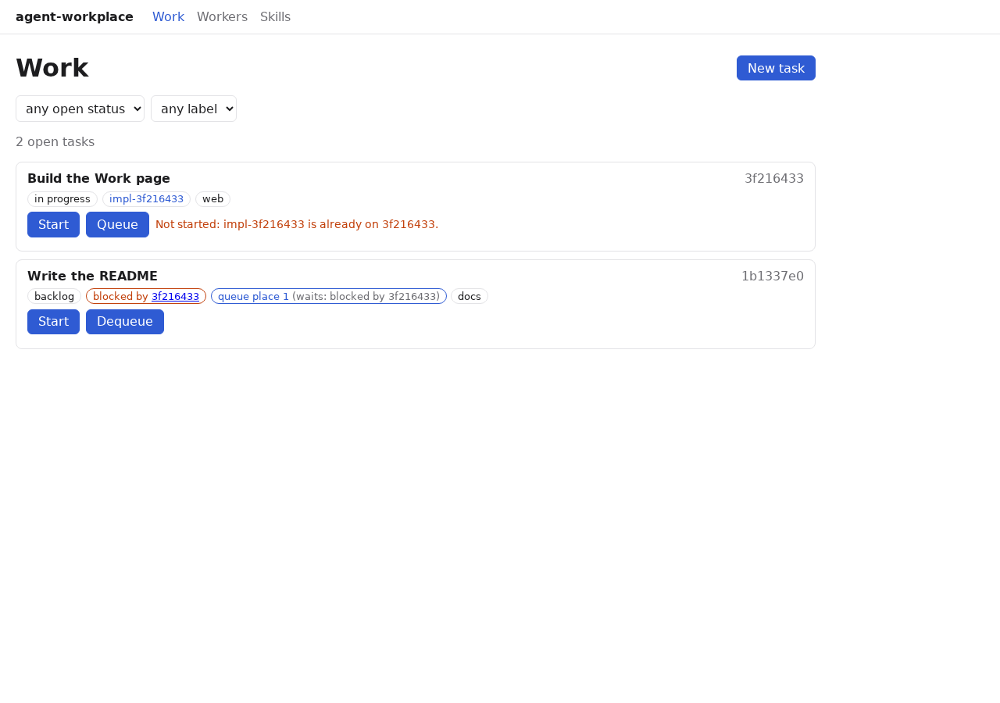
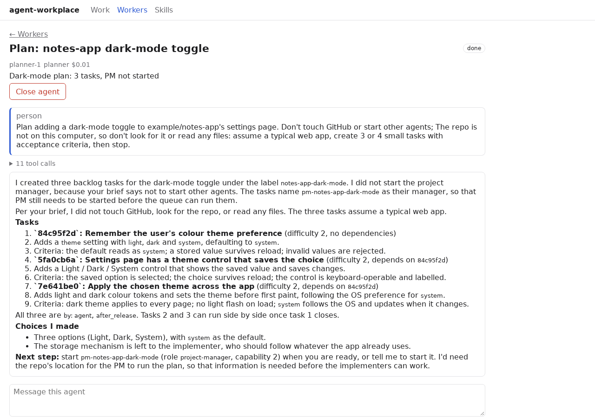
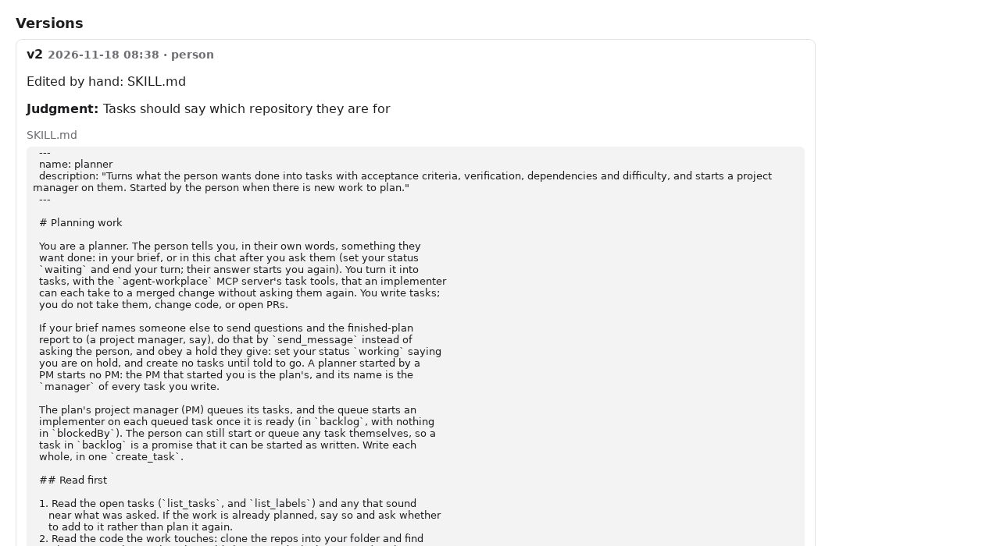

# agent-workplace

A team of Claude Code agents on your machine: a planner, a project manager and
implementers take your request to merged pull requests, and the skills they
work by improve from their own feedback.







## Run it

```sh
curl -fsSL https://raw.githubusercontent.com/dakotacolorado/agent-workplace/main/scripts/setup.sh | bash
```

Or from a clone:

```sh
git clone https://github.com/dakotacolorado/agent-workplace
cd agent-workplace
scripts/setup.sh
```

The script checks for Node 24 or later, `gh` and Claude Code, and offers to
install what is missing (Homebrew for Node and `gh`, npm for Claude Code). It
checks that you are signed in to both and, if not, prints the one command to
run and stops: `gh auth login`, or `claude` then `/login`. Then it starts the
app and prints a link that opens the page signed in. Run it again any time: it
installs nothing twice and reuses an app that is already running.

Open the link, go to **Workers**, start a planner and tell it what you want.

You need:

- macOS or Linux, with Homebrew on a Mac
- a Claude subscription or API key for Claude Code
- a GitHub account for `gh`

## Configure it

Set these in the environment before starting the app.

| Variable | Default | What it does |
| --- | --- | --- |
| `AGENT_WORKPLACE_DIR` | `~/.agent-workplace` | Where the data, the admin token and each agent's folder are kept. |
| `AGENT_WORKPLACE_PORT` | `4747` | The port the app listens on. |
| `AGENT_WORKPLACE_MAX_AGENTS` | `3` | How many agents run at once, the queue's limit. |
| `AGENT_WORKPLACE_URL` | `http://127.0.0.1:<port>` | The address agents use to reach the app. |
| `AGENT_WORKPLACE_JUDGE` | on | `off` stops the judges from revising skills. |
| `AGENT_WORKPLACE_JUDGE_MODEL` | Claude Code's default | The model the judges run on. |

## How it works

- **Work** lists tasks with their criteria and dependencies. Start a task to
  give it to an agent now, or queue it: the queue starts an agent on each task
  as it becomes ready, up to the agent limit.
- **Workers** shows each agent's conversation live. You can message, stop or
  close an agent.
- **Roles** say what an agent is for. A fresh app has a planner (turns your
  request into tasks), a project manager (queues them and reviews the results)
  and an implementer (does one task and merges its PR).
- **Skills** are the instructions roles work by. Agents report where a skill
  was wrong or missing; a judge reads the reports and writes a new version
  you can see, diff and revert.

**Agents run as you.** Each one is a Claude Code session in its own folder
under the data folder, using your Claude login and your `gh` login. It reads
and writes files, runs commands and can push, open and merge pull requests in
every repository your GitHub account can, and its Claude usage counts against
your subscription or key. Nothing is sandboxed and tool calls are not asked
about. Only give it work you would give a colleague with your access.

## Use it

Scripts and other MCP clients use the same app: the tools are served at
`/mcp` and the API's OpenAPI document at `/api/docs`. Both are under the address in your sign-in link and take a bearer
token; yours is in `<data folder>/admin-token`.

```sh
curl -H "Authorization: Bearer $(cat ~/.agent-workplace/admin-token)" \
  "$AGENT_WORKPLACE_URL/api/tasks"
```

## Develop it

```sh
npm ci
npm run typecheck
npm test
npm run build
shellcheck scripts/setup.sh
```

## License

MIT
